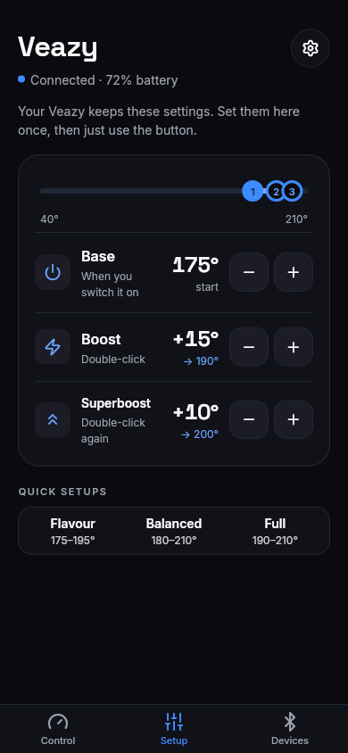
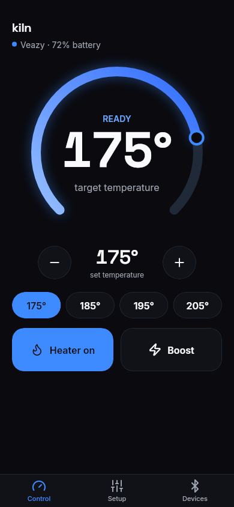
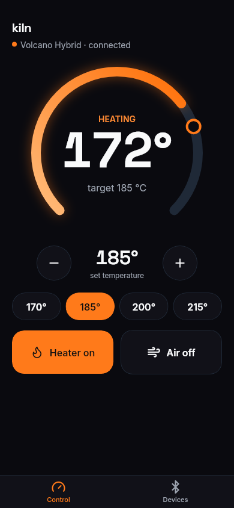

# kiln

An unofficial, open-source app for Storz & Bickel vaporizers: **Volcano Hybrid**,
**Venty** and **Veazy**, over Bluetooth. Built with Flutter.

> **Unofficial.** kiln is not affiliated with, endorsed by or supported by
> Storz & Bickel. It talks to your device through a reverse-engineered
> protocol. Use it at your own risk.

<p align="center">
  
  
  
</p>

## Features

### Veazy and Venty

- Live status: target temperature, heating / ready, battery and charging
- "Set it once" setup: base temperature, boost and superboost offsets, with
  quick setups (Flavour, Balanced, Full)
- Heater, boost and superboost from the phone: the Boost button steps through
  boost, superboost and back to the base temperature
- Device settings: charge limit, battery saver, vibrate when ready, boost on
  the LEDs, °C/°F, find my device
- Haptic feedback for every step and a "Saved" confirmation

### Volcano Hybrid

- Live temperature on a gauge, counting up smoothly while it heats
- Target temperature with − / + and presets
- Heater and air on and off

### Demo mode

No device at hand? "Try the demo" on the welcome or devices screen opens a
simulated Volcano Hybrid, Venty or Veazy. They heat up, report their battery
and react to every control. Nothing connects over Bluetooth and nothing is
saved; the device screens show a "Demo" badge that leaves the demo.

### All devices

- Remembers your devices and reconnects to the last one on its own
- App colours follow your device's finish (Ember, Lava, Blue, Pink, Mono),
  detected automatically on the Veazy
- English and German
- Light and dark mode; respects "reduce motion"

Neither the Venty nor the Veazy reports its current temperature over
Bluetooth, so kiln shows the target for those.

## Safety

- Every Bluetooth write goes through an allow-list. Anything not confirmed
  against the official app or on real hardware is never sent.
- There is no firmware update, bootloader, factory reset or diagnostics code in
  the app, not even as constants.
- Temperatures are capped before sending: Volcano 40–230 °C, Venty/Veazy
  40–210 °C. The devices' own limits and overheat protection always apply.
- kiln can start a Volcano from another room. Only do that when it can heat
  safely unattended. kiln never changes its auto-shutdown.

## Install

kiln is not in any app store. Apple does not allow vaporizer apps in the App
Store, so for now there is no iPhone version you can just install.

**Android:** download `kiln-vX.Y.Z.apk` from the
[latest release](https://github.com/BenAuerDev/kiln/releases/latest) and open
it on your phone (allow installing from your browser or file manager when
Android asks). Updates install over the old version. The `.sha256` file next to
the APK lets you check the download:

```sh
sha256sum -c kiln-vX.Y.Z.apk.sha256
```

Or build it yourself (see below) and run it straight onto a phone connected
over USB:

```sh
flutter run --release
```

**iPhone:** possible with a Mac, Xcode and an Apple developer account, but not
tested yet.

## Development

Requirements: Flutter ≥ 3.41 (Dart ≥ 3.11) and a real phone. Bluetooth does
not work in the iOS simulator or the Android emulator.

```sh
flutter pub get          # also fetches Obers UI from GitHub
flutter run              # debug build, logs every Bluetooth packet
flutter build apk        # release APK in build/app/outputs/flutter-apk/
```

Before committing:

```sh
dart format .
flutter analyze
flutter test
```

After changing an `.arb` file, run `flutter gen-l10n`. After changing the app
icons in `assets/icons/`, run `dart run flutter_launcher_icons`. The README
screenshots are rendered with sample data:

```sh
flutter test tool/screenshots/readme_screenshots_test.dart --update-goldens
```

### Releases

Release APKs are signed with kiln's own key. The keystore and its passwords
never enter the repo: `android/key.properties`, `*.jks` and `*.keystore` are
git-ignored. Without `key.properties`, a release build is signed with the debug
key (Gradle prints a warning), so anyone can still build and run kiln.

**One-time setup: create the keystore.** Keep it outside the repo and back it
up together with its password. If it is lost, no update can be installed over
an existing kiln; everyone would have to uninstall first.

```sh
mkdir -p ~/keys
keytool -genkeypair -v \
  -keystore ~/keys/kiln-release.jks -storetype PKCS12 \
  -keyalg RSA -keysize 4096 -validity 10000 \
  -alias kiln
```

PKCS12 uses one password for the store and the key. To sign local release
builds, create `android/key.properties`:

```properties
storeFile=/home/<you>/keys/kiln-release.jks
storePassword=<password>
keyAlias=kiln
keyPassword=<password>
```

**One-time setup: GitHub secrets** (Settings → Secrets and variables →
Actions), or with the GitHub CLI:

| Secret | Value |
|---|---|
| `KILN_KEYSTORE_BASE64` | the keystore, base64-encoded on one line |
| `KILN_KEYSTORE_PASSWORD` | the keystore password |
| `KILN_KEY_ALIAS` | `kiln` |
| `KILN_KEY_PASSWORD` | the key password (same as the keystore password for PKCS12) |

```sh
base64 -w0 ~/keys/kiln-release.jks | gh secret set KILN_KEYSTORE_BASE64
gh secret set KILN_KEYSTORE_PASSWORD
gh secret set KILN_KEY_ALIAS --body kiln
gh secret set KILN_KEY_PASSWORD
```

**Cutting a release:**

1. Bump `version:` in `pubspec.yaml`, e.g. `0.2.0+2`. The part after `+` is
   Android's version code and must go up with every release.
2. Commit, then tag with the same version and push the tag:
   ```sh
   git tag v0.2.0
   git push origin v0.2.0
   ```
3. [`.github/workflows/release.yml`](.github/workflows/release.yml) checks that
   the tag matches `pubspec.yaml`, runs format, analyze and the tests, builds
   the APK, checks it is not signed with the debug key and publishes a GitHub
   release with `kiln-v0.2.0.apk`, its SHA-256 and generated release notes.

The workflow pins the Flutter version; update `flutter-version` there when
upgrading Flutter locally.

### Where things are

- [`ARCHITECTURE.md`](ARCHITECTURE.md): the architecture rules. Read this first.
- [`docs/protocol.md`](docs/protocol.md): the Bluetooth protocol, its sources
  and what was tested on real devices.
- [`docs/plan.md`](docs/plan.md): folder layout, use cases and design decisions.
- [`docs/conventions.md`](docs/conventions.md): coding conventions.
- [`docs/brief.md`](docs/brief.md): the original brief.
- [`design/`](design/): the design mockups ([`design/DESIGN.md`](design/DESIGN.md) is the index).
- `lib/core/`: Bluetooth client (with the demo devices in `ble/demo/`),
  router, theme (all colours in `kiln_palette.dart`), localisation and shared
  widgets.
- `lib/features/`: `devices`, `portable` (Venty/Veazy), `volcano` and
  `app_settings`.

## Not done yet

- °F in the app (it always shows °C)
- Crafty+ support
- Insights, Volcano workflows, sharing setups, home-screen widgets
- iOS build and alternate iOS icons per finish

## Credits

The protocol was worked out from the official web app and cross-checked with
these open-source projects:
[storzandbickel-ble](https://github.com/lorek123/snb-ble),
[reactive-volcano-app](https://github.com/firsttris/reactive-volcano-app),
[venty-android](https://github.com/orth4x0r/venty-android),
[Volcano-Remote](https://github.com/xythobuz/Volcano-Remote) and
[storz-rs](https://github.com/flakesonnix/storz-rs).

UI built with [Obers UI](https://github.com/SimonErich/obers_ui). Fonts:
[Inter](https://rsms.me/inter/) and [Space Grotesk](https://github.com/floriankarsten/space-grotesk),
both under the SIL Open Font License (`assets/fonts/OFL-*.txt`).

The demo mode idea comes from
[venty-android](https://github.com/orth4x0r/venty-android) (MIT); kiln's
simulator is its own code.

Bluetooth via [flutter_blue_plus](https://github.com/chipweinberger/flutter_blue_plus),
used under its non-profit licence: kiln is a non-commercial project.

## Licence

[MIT](LICENSE). Dependencies keep their own licences; note that
`flutter_blue_plus` needs a paid licence for commercial use.

"Storz & Bickel", "Volcano", "Venty", "Veazy" and "Crafty" are trademarks of
their owner and are used here only to name the devices kiln works with.
